 

## 👨‍💻 About me

Hi，我是 **Strivo**。写代码，也把想法做成产品。

- 🔭 正在迭代 [红果短剧 Mac 版](https://github.com/StriveToLearnCode/hongguo-short-drama-macos)，打磨桌面端的使用体验。
- 🧩 参与 [Versakit Vue](https://github.com/Versakit/Versakit-Vue)，改进组件无障碍和单元测试。
- 🤖 探索 AI 应用与开发工作流，喜欢把重复的事情变成工具。
- 💬 欢迎交流前端开发、桌面应用和开发者工具。

## 🛠️ Tech stack

  

## 🚀 Projects

- [**红果短剧 Mac 版**](https://github.com/StriveToLearnCode/hongguo-short-drama-macos) — 非官方 macOS 客户端，支持收藏、续播与置顶小窗。
- [**Versakit Vue**](https://github.com/Versakit/Versakit-Vue) — Vue 3 桌面端组件库；我参与组件无障碍与测试改进。
- [**LLM Component**](https://github.com/StriveToLearnCode/LLM-Component) — 面向大模型对话的 Vue 3 富文本组件，支持图片与 PDF。
- [**Project Doctor**](https://github.com/StriveToLearnCode/project-doctor) — TypeScript 项目诊断 CLI，检查依赖、环境与工程文件。

## 📊 GitHub stats

  
  

---

  <b>Code · Build · Share</b> 
  Thanks for stopping by. Let's build something useful.

